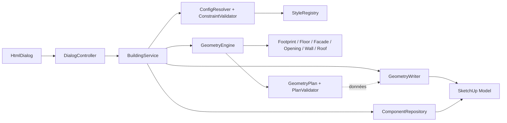

# Architecture Ruby



Le noyau (Core + Geometry) ne dépend que de Ruby standard et des données déjà chargées par le point de composition. Aucun solveur ne lit de fichier. L'adaptateur seul touche aux classes natives. L'UI ne reproduit aucune règle de faisabilité. Le contrôleur possède les jetons de session et de confirmation ; il les valide et transmet au service la référence Ruby de cible (PID, révision, digest et identité de définition), que le service relit et contrôle avant mutation.

| Classe / module | Signature de référence | Responsabilité |
|---|---|---|
| Core::StyleRegistry | fetch(profile_id, revision: nil) → StyleProfile | Héritage, capacités, révision exacte ou courante ; révision absente ⇒ erreur. |
| Core::ConfigResolver | resolve(request, registry:, base: nil) → Result<BuildingConfig> | Vérifier types, fusionner, valider. Création/import sans base ; édition sur base résolue. |
| Core::BuildingConfig | to_h → Hash ; geometry_input → Hash | Copie profonde gelée ; version, valeurs résolues ; projection sans libellé. |
| Core::ConstraintValidator | call(config, profile:) → Diagnostic[] | Contraintes transversales et cohérence historique ; paths JSON Pointer. |
| Core::DeterministicRandom | unit(seed, key) → Float | Tirages stables par clé sémantique ; voir contrat géométrique. |
| Core::GeometryEngine | generate(config) → Result<GeometryPlan> | Pipeline pur, valide le plan avant retour. |
| Adapters::SketchUp::BuildingService (assise) | preview_site, adapt_to_site, remove_site, site_status | Une opération par action ; relevé refait avant d'écrire. |
| Adapters::SketchUp::TerrainSurveyor | retain(model), survey(model, ref, instance, axes) → Result | Terrain désigné, rayons verticaux, obstacles ; aucune écriture. |
| Core::SiteIntake | settings(input), stored_settings(input), grid(tree, ...) → Result | Réglages d'assise et grille de relevé, chemins sous /site. |
| Core::SurveyGrid | plan(...) → Result<axes> ; altitude_at(x, y) | Axes attendus, altitudes, interpolation bilinéaire. |
| Core::SiteAssise | call(grid, settings, width_m:, depth_m:) → Result<Hash> | Plateforme, relief et indicateurs. |
| Geometry::SitePlanner | call(plan:, config:, grid:, settings:, assise:) → Result<SitePlan> | Plancher et soubassement, porte et baies enterrées, budgets ; plan du bâtiment non modifié. |
| Geometry::EmbankmentBuilder | call(footprint:, grid:, settings:, platform:) → Result | Rayons, pied de talus, angles en éventail. |
| Core::SitePlanValidator | call(site_plan, materials:) → Diagnostic[] | Mêmes refus de maillage que le plan du bâtiment. |
| Geometry::FootprintSolver | call(width_m:, depth_m:) → Footprint | Anneau CCW et repères de façades. |
| Geometry::FloorPlanner | call(footprint, levels) → Level[] | Altitudes, plages de dalle. |
| Geometry::FacadeSolver | call(footprint, levels, facade) → Candidate[] | Positions candidates à pas constant. |
| Geometry::OpeningSolver | call(candidates, config) → Result<Opening[]> | Percements et diagnostics. |
| Geometry::WallBuilder | call(footprint, levels, openings, config) → Node[] | Murs et éléments de dalle selon mode. |
| Geometry::RoofSolver | call(footprint, wall_top_z, roof) → Node[] | Pans, pignons et altitude totale. |
| Geometry::DetailSolver | call(plan_parts, config) → Node[] | Détails LOD 1 compatibles ; ne déplace pas les percements. |
| Core::PlanValidator | call(plan) → Diagnostic[] | Topologie, indices, limites et matériaux. |
| Adapters::SketchUp::GeometryWriter | write(plan, entities:, resources:) → WriteStats | Géométrie native dans une définition vide ; ne crée ni transaction ni racine. |
| Adapters::SketchUp::ComponentRepository | read(model, persistent_id:) ; insert(model, definition:, transform:) ; swap(instance, definition:) | Identifie, lit et écrit les racines ; contrôle appartenance, révision et contexte. |
| Adapters::SketchUp::BuildingService | preview(draft:, model: nil, target: nil) ; create(model:, draft:) ; load_building(model:, persistent_id:) ; load_selection(model:) ; regenerate(model:, target:, draft:) | Résout, calcule, vérifie le contexte, tient la transaction et le journal des ressources. |
| UI::DialogController | dispatch(envelope) → Response | Liaison modèle/session, validation du protocole et sérialisation. |

`Result` contient `value` en cas de succès et toujours `diagnostics`. Un diagnostic : `{code, severity, path, params}` ; severities `error` et `warning`. Les erreurs attendues reviennent en données ; une anomalie inattendue du writer remonte au service pour abandon. Aucun objet SketchUp dans les diagnostics.

```text
archgen.rb                         # enregistre l'extension uniquement
archgen/
  main.rb  version.rb
  core/                            # config, registre, engine, plan, validateurs, RNG
  geometry/                        # types et solveurs
  adapters/sketchup/                # writer, repository, ressources, service
  styles/{profiles,materials}/     # JSON locaux contrôlés
  ui/                              # contrôleur Ruby + HTML/CSS/JS
test/{unit,contract,fixtures,host}/
scripts/                           # vérification, benchmark, packaging
AGENTS.md  README.md  docs/  planning/  schemas/  examples/
```

Les modules runtime sont sous `Archgen`. `main.rb` assemble les dépendances et installe une commande unique. Les ports du writer et du repository sont injectables dans les tests ; les doubles ne valident pas les comportements natifs. Une future sortie Blender peut lire le plan sérialisé ; le format V1 est interne et évolue par version, sans contrat d'export public.
