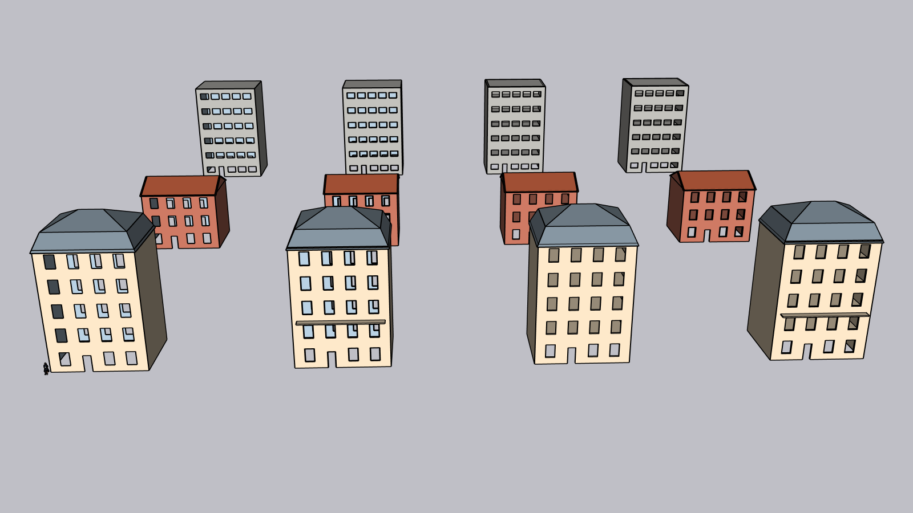
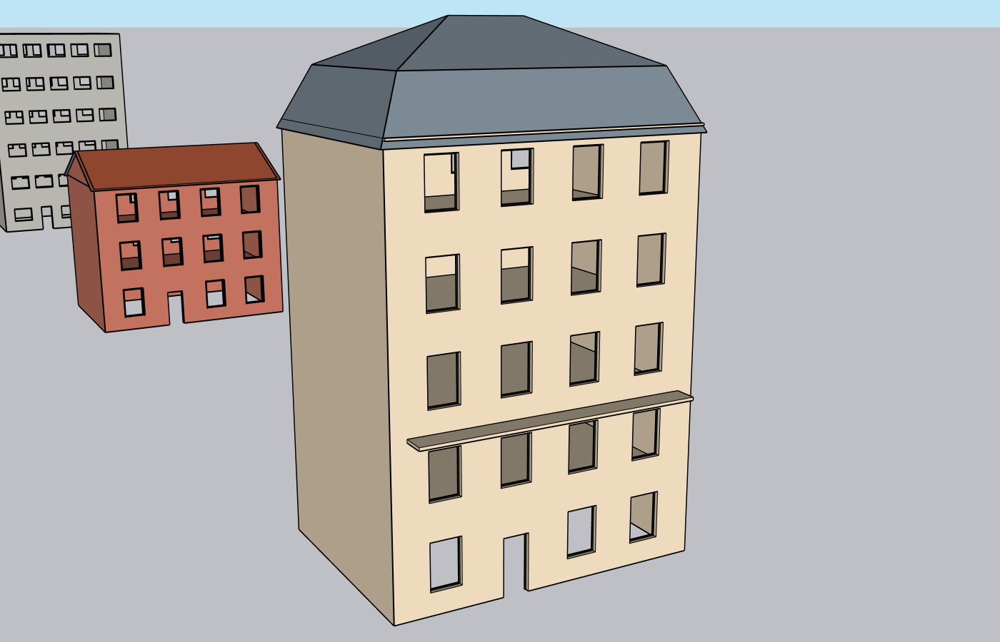
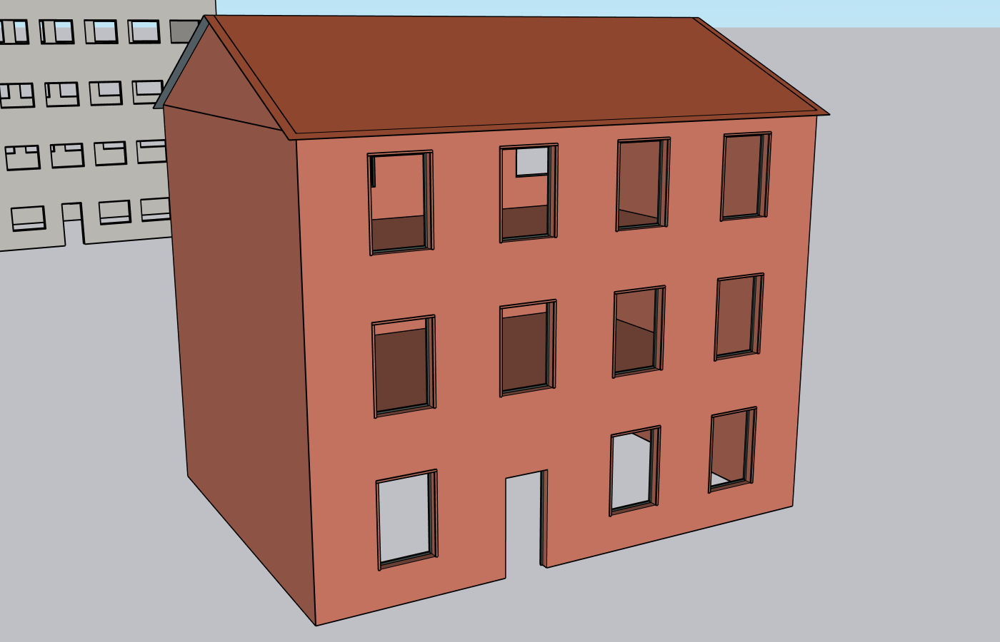
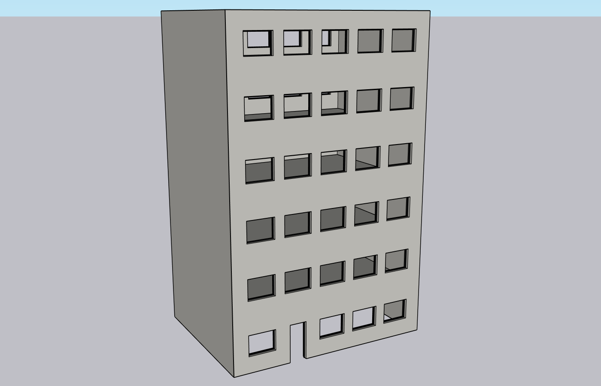

# Recette hôte H08 — trois profils, LOD 0 et 1, Shell et Structural

**Résultat : réussi sur la seule combinaison ci-dessous** : 135 contrôles, aucun échec. Création par le service réel, sans profil interne ; le panneau de choix arrive avec AG-016.

| Élément | Valeur |
|---|---|
| Date | 2026-11-05 |
| Code | Commit de ce rapport sur `dev/v0.1` ; moteur 1 ; extension 0.1.0-dev ; RBZ de 56 fichiers |
| OS | Windows 11 Home 10.0.26200 |
| Hôte | SketchUp 2026, 26.2.243, Ruby embarqué 3.2.2 |
| Sonde | `test/host/styles.rb`, non incluse dans le RBZ |
| Fixtures | Défauts de chaque profil : 12 bâtiments, soit 3 profils × 2 modes × 2 LOD |

## Signatures observées

| Profil | Rendu Structural LOD 1 | Murs / toit / cadres | Détails LOD 1 |
|---|---|---|---|
| Haussmannien |  | Pierre calcaire / zinc / bois peint | Mansarde, corniche, balcon au niveau 2 seulement, à 5 niveaux |
| Toulousain |  | Brique foraine / tuile canal / bois peint | Deux pans, encadrements, ni corniche ni balcon |
| Brutaliste |  | Béton / béton / métal foncé | Toit plat, grille de 5 travées, cadres reculés de 0,16 m en Structural |

## Contrôles

| Contrôle, pour chacune des 12 variantes | Résultat |
|---|---|
| Aucun avertissement sur les défauts du profil | OK |
| Plan créé identique à celui de l'aperçu | OK |
| Faces natives égales au compte étendu du plan | OK |
| Rayon au centre de chaque baie : cadres et encadrements ne bouchent rien | OK |
| Matériaux de mur et de toit conformes au profil | OK |
| LOD 0 : aucun groupe de détails | OK |
| LOD 1 : un cadre par baie, tag « ARCHGEN Détails », barre de cadre manifold | OK |
| LOD 1 : corniche, encadrements et balcons conformes aux réglages du profil | OK |

| Par profil, sur ses quatre variantes | Haussmannien | Toulousain | Brutaliste |
|---|---|---|---|
| Cotes communes (largeur, profondeur) | 12 × 9 m | 12 × 9 m | 12 × 9 m |
| Tête de mur | 16,00 m | 9,30 m | 18,60 m |
| Sommet du plan = sommet natif mesuré | 19,60876 m | 11,30353 m | 18,60000 m |
| Baies, communes aux quatre variantes | 40 | 24 | 60 |

| Mutualisation et régénération | Résultat |
|---|---|
| Une définition de cadre par clé | 4 définitions, exactement les clés des plans |
| Instances de cadres | 248 pour 4 définitions, Shell et Structural partageant les mêmes |
| Régénérer à l'identique | Même plan, toujours 4 définitions de cadres |
| Passer du Haussmannien au Toulousain en LOD 1 | Réussi, encadrements apparus |

## Limites

- **Pas de vitrage ni de garde-corps :** conforme au contrat. Les baies restent vides et le balcon est une dalle simple.
- **Lecture des styles :** elle reste volontairement simple, avec des matériaux unis et des barres de 4 cm. L'avis sur la ressemblance est le tien, pas un test.
- **H03 à H07 non rejoués sur ce code.** Ils portent sur le LOD 0, dont le plan n'a pas changé (digests vérifiés) ; la création et la régénération en LOD 1 sont exercées ici, mais pas Annuler et Rétablir ni les pannes en LOD 1. Ces derniers sont couverts avec doubles, et à rejouer en AG-018.
- **Digests des profils :** figés sous Windows dans `test/fixtures/profile_plan_digests.json`. Ils dépendent de `tan` ; à vérifier sur les autres OS dès que la CI tournera.
- Une seule version et un seul OS ; le plancher 2024 et macOS restent à tester (AG-019).
