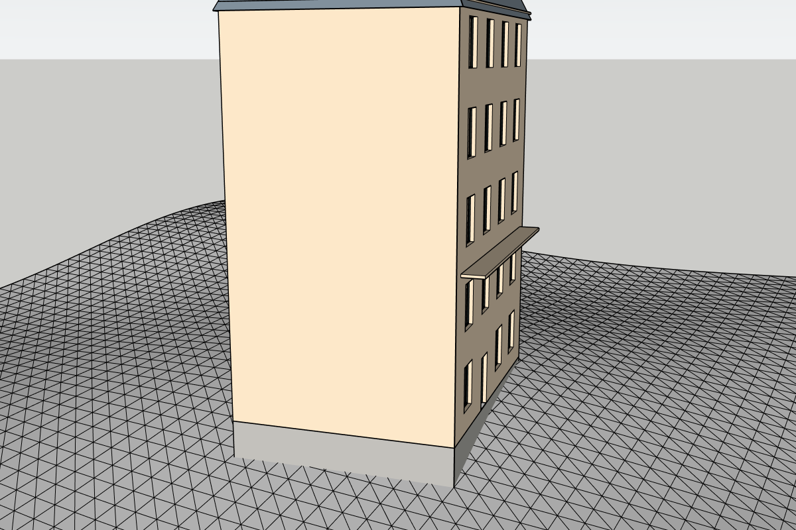
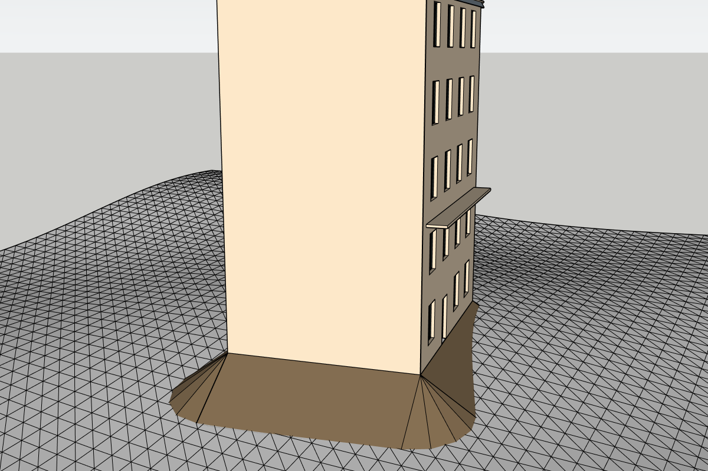

# Recette hôte H13 — terrain

**Réussie sur la seule combinaison ci-dessous, après correction d'un défaut du produit trouvé par cette recette.** Le relevé (AG-024) n'écrit rien dans le modèle ; l'écriture (AG-025) tient en une entrée d'Annuler et laisse le terrain intact. Le parcours au panneau et la charge relèvent de H14 (AG-026).

| Élément | Valeur |
|---|---|
| Date | 2026-11-06 |
| Code | Commit de ce rapport sur `dev/v0.1` ; extension 0.2.0-dev copiée dans Plugins ; moteur 1 |
| OS | Windows 11 Home 10.0.26200 |
| Hôte | SketchUp 2026 Pro, 26.2.243, Ruby embarqué 3.2.2 |
| Sondes | `test/host/survey.rb` et `test/host/site_write.rb`, non incluses dans le RBZ ; une commande console chacune, rapports `tmp/h13-releve.txt` et `tmp/h13-ecriture.txt` |
| Terrain | 7 200 faces, groupe dans un groupe, décalé et pivoté de 20° ; altitude connue partout |
| Bâtiment | 12 × 9 m, déplacé et pivoté de 30°, posé dans le terrain : les rayons le traversent |

**Méthode.** La sonde passe par le service réel et le vrai `raytest`. Chaque altitude relevée est comparée à celle du plan du triangle de maillage qui contient le point, calculée indépendamment. Derniers passages : relevé 26 contrôles et écriture 68 contrôles, 0 échec.

## Altitudes

| Relevé | Nœuds comparés | Écart maximal | Durée |
|---|---|---|---|
| Soubassement, pas de 2 m | 42 | 0,039 mm | 47 ms |
| Soubassement, pas de 1 m | 130 | 0,039 mm | 108 ms |
| Talus, pas de 2 m, avec marge | 342 | 0,040 mm | 270 ms |

Le seuil est de 1 mm. L'écart vient du décalage volontaire de 0,2 mm des rayons, voir le défaut ci-dessous ; il était de 0,0005 mm sans ce décalage. Durées indicatives, sur un portable non isolé.

## Contrôles

| Situation | Attendu | Résultat |
|---|---|---|
| Aucune sélection, ou deux entités | `terrain_selection` | OK |
| Bâtiment ARCHGEN sélectionné | `terrain_is_building` | OK |
| Face libre | `terrain_kind` | OK |
| Groupe de terrain | Retenu | OK |
| Référence à une entité imbriquée | `terrain_nested` | OK |
| Référence d'un autre document | `terrain_other_document` | OK |
| Groupe, puis tag du terrain masqués | `terrain_hidden` | OK |
| Racine inclinée de 10° | `not_horizontal` | OK |
| Terrain ouvert en édition : relever, retenir | `nested_edit_context` | OK |
| Boîte au-dessus d'un nœud | Relevé identique, même empreinte | OK |
| Trou sous l'angle du bâtiment | `missing_points` à [0, 0] | OK |
| Deux relevés | Même empreinte | OK |
| Inventaire du modèle et état « modifié » | Inchangés | OK |
| Attributs du terrain | Aucun | OK |
| Sentinelle, deux relevés, un Annuler | La sentinelle disparaît : aucune ligne ajoutée | OK |

## Noyau dans le Ruby de SketchUp

Sur la grille réelle, le noyau d'assise tourne dans le Ruby embarqué : soubassement en 23 faces, avec un seuil de porte à 0,85 m et l'avertissement `W_SITE_DOOR_GAP` ; talus en 59 faces, d'une emprise de 3,22 m. Ces plans sont seulement calculés : ni leur écriture ni leur aspect ne sont vérifiés.

## Écriture de l'assise

Bâtiment Haussmannien de 12 × 9 m, Structural LOD 1, 1 844 faces, déplacé, pivoté de 30°, avec un nom, un tag et un attribut d'une autre extension. Plateforme à 10,839 m, remblai maximal de 1,543 m, aucun déblai.

| Contrôle | Résultat |
|---|---|
| Soubassement écrit : 23 faces | Faces natives = bâtiment + assise |
| Bas de bande à l'angle (0, 0) | À terrain − 5 cm, à 1 mm près |
| Z de la racine | À la plateforme, à 1 mm près |
| PID, X, Y, rotation, nom, tag, attribut tiers | Conservés |
| Révision 2, empreinte du plan du bâtiment | Révision à 2, empreinte inchangée |
| Ancienne définition | Intacte |
| Tag du groupe d'assise | « ARCHGEN Terrassement » |
| Sommets du terrain, avant et après chaque écriture et Annuler | Empreinte identique |
| Annuler puis Rétablir | Définitions, matériaux, tags, placement et attributs retrouvés à l'identique |
| 5 pannes : avant l'assise, après ses faces, après la pose, au milieu des attributs, à la relecture | `E_WRITE`, rien ne reste, ni matériau Terre ni restauration incomplète |
| Un Annuler après les pannes | Défait bien l'adaptation : aucune ligne ajoutée |
| Terrain déplacé de 2 cm entre l'aperçu et l'écriture | `terrain_changed`, aucune écriture |
| Talus : 59 faces, emprise de 3,22 m | Même plateforme, plus de bande, matériau Terre créé |
| Enregistrer et rouvrir | Empreinte et réglages identiques ; écart de matrice de 2 × 10⁻¹⁶ |
| Régénérer à 14 m après réouverture | Assise conservée, altitude à la nouvelle plateforme |
| Déplacer de 4 m et 3 m | Assise signalée périmée ; régénérer relit le nouvel emplacement |
| Terrain masqué, puis régénérer | Refus, assise conservée |
| Copie régénérée | À son emplacement, avec sa définition ; original inchangé |
| Retirer l'assise, Annuler, Rétablir | Altitude inchangée ; états retrouvés |

Vues produites par SketchUp pendant la recette, regardées : le soubassement gris ferme le bas du mur, le talus brun descend jusqu'au terrain et les éventails d'angle sont continus.

## Non-régression

Toutes les recettes existantes ont été rejouées sur ce code avec `test/host/v01.rb`, vrai copier-coller de H05 compris : H02 à H12, 21 rapports, aucun échec. Mesures H11 du même ordre qu'en V0.1 : écriture Haussmann Structural LOD 1 en 89 ms (p95), 24 × 18 Toulousain en 903 ms, 20 régénérations +0,89 Mo. La relecture de l'export dans Blender n'a pas été refaite : le writer des bâtiments n'a pas changé.

## Défaut trouvé et corrigé

**Après une assise, un nouveau relevé refusait un point valide.** Le nœud (12 ; 7,2) tombe exactement sur une arête verticale du soubassement déjà écrit : le rayon file le long de l'arête et `raytest` ne renvoie plus rien. Le terrain paraissait troué. Les doubles ne pouvaient pas le voir. Correctif : chaque rayon est décalé de 0,2 mm en X et en Y dans le repère de la racine, et un test de contrat vérifie qu'aucun rayon n'est dans le plan d'un mur.

## Écarts pendant la recette

Aucun autre écart ne vient du produit.

| Écart | Conséquence |
|---|---|
| Premier passage, 5 échecs : `survey('earthwork' => …)` pris pour un mot-clé par Ruby | Accolades ajoutées à la sonde |
| Trou non creusé : la sonde effaçait ce que le rayon touchait en premier, y compris le bâtiment | N'efface plus que le terrain ; document de test neuf à chaque passage |
| « Annuler : tout revient » échouait sur la sélection, relevée avant de sélectionner | Relevé fait après la sélection |
| « Placement identique » après réouverture : comparaison stricte de nombres flottants | Écart mesuré de 2 × 10⁻¹⁶, tolérance de 10⁻⁶ pouce, valeur publiée |
| Le lancement de SketchUp ouvre une nouvelle instance si une autre existe déjà | Vérifier les processus avant de lancer |

## Limites

- **Un seul terrain mesuré**, de 7 200 faces. La charge sur 100 000 faces et un bâtiment de 60 × 60 m relèvent de H14 (AG-026).
- **Obstacles :** une boîte et le bâtiment seulement. La limite de 64 relances n'est vérifiée qu'avec des doubles.
- **Pas de panneau :** le service est appelé directement. Le panneau arrive en AG-026.
- **Annuler et Rétablir :** par l'API. Le libellé « Annuler ARCHGEN : adapter au terrain » au menu n'a pas été lu.
- **Copie :** faite par l'API, en recopiant les attributs. Le vrai copier-coller est prouvé en H05 sur un bâtiment sans assise.
- **Terrain modifié :** le test le déplace en bloc ; une retouche locale du maillage n'est pas testée, mais change aussi l'empreinte du relevé si elle touche un nœud. Une retouche entre deux nœuds n'est pas détectée.
- **Terrain réel :** maillage de synthèse, sans découpe propre ni géométrie importée.
- **Aspect :** deux vues d'un seul bâtiment ; les raccords sur un relief plus accidenté restent à juger.
- **Tag masqué par un dossier de tags :** non testé. Le terrain serait alors manquant aux yeux du rayon, donc refusé, mais avec un autre message.
- **Console :** dernier affichage seulement ; le rapport ne contient aucune exception.
- SketchUp 26.2.243 sous Windows seulement (ADR-26).
