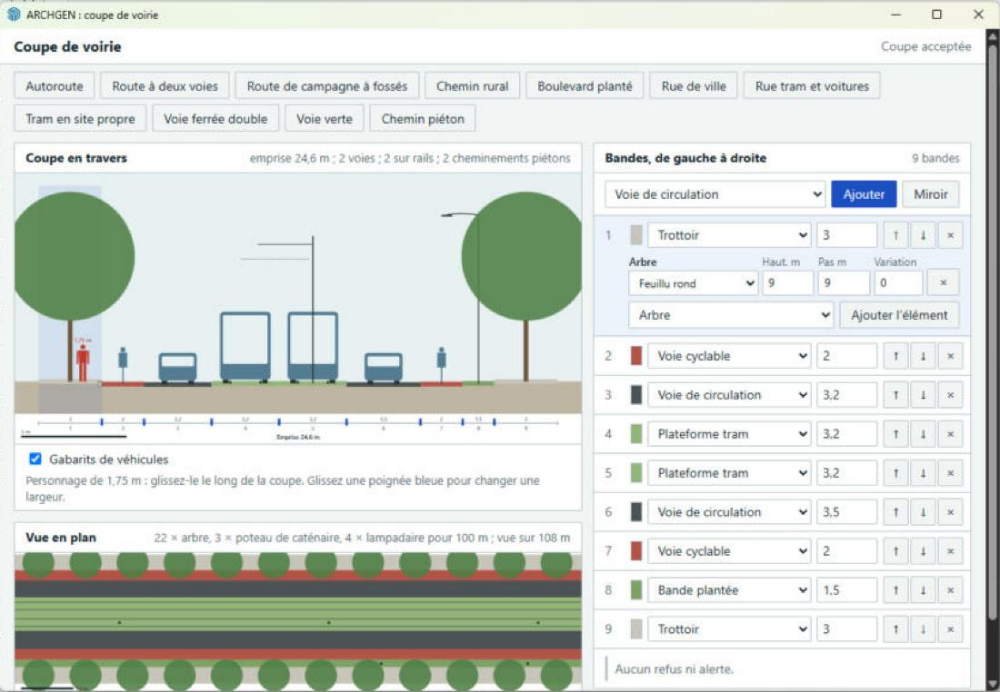

# Recette hôte H19 : éditeur de coupe de voirie

**Réussie sur la copie de développement 0.5.0-dev installée, sur la seule combinaison ci-dessous, après correction de deux défauts du produit vus dans le vrai SketchUp.** L'éditeur compose une coupe à l'échelle humaine, Ruby la juge et la dessine, et le modèle ne change jamais.

| Élément | Valeur |
|---|---|
| Date | 2026-11-07 |
| Code | Copie de développement `archgen/` 0.5.0-dev dans le dossier Plugins, identique au dépôt (`diff -r`) ; l'ancienne 0.4.0 est gardée dans `tmp/plugins-avant-ag038/`. Pas de RBZ : il viendra avec AG-042 |
| OS | Windows 11 Home 10.0.26200 |
| Hôte | SketchUp 2026 Pro, 26.2.243, Ruby embarqué 3.2.2 |
| Sonde | `test/host/h19.rb`, non incluse dans le paquet ; rapport `tmp/h19.txt` |
| Résultat | 22 contrôles, 0 échec, dont 102 objets mesurés un à un, sur un SketchUp redémarré (rejeu du 2026-11-07 à 12 h 16, après la vérification des échelles) |

## Sonde, par le DOM du vrai panneau

| Contrôle | Résultat |
|---|---|
| Ouverture : onze préréglages, rue de ville acceptée | OK |
| Chacun des onze préréglages accepté, dessiné, sans alerte | OK × 11 |
| **Échelle mesurée à l'écran**, tram en site propre : personnage de 1,750 m, pieds à 0,000 m du sol ; bandes de 3,000 2,000 3,200 3,200 3,200 3,200 2,000 3,000 m, contre 3 2 3,2 3,2 3,2 3,2 2 3 attendus | OK |
| Largeur de 9 m refusée sur sa bande, message du contrat, coupe grisée | OK |
| Saisie illisible jamais envoyée | OK |
| Largeur à virgule acceptée, préréglage quitté | OK |
| Ajouter une bande après la sélection, Miroir, ajouter un lampadaire | OK |
| Fermer puis rouvrir : la dernière coupe acceptée revient | OK |
| Modèle inchangé : entités, définitions, matériaux, balises, état modifié | OK, `[1, 1, 21, 1, false]` avant et après |

Mesure : rapport des longueurs à l'écran à la barre d'échelle de 5 m dessinée dans la coupe.

## Échelle de chaque objet

Demande du propriétaire : vérifier toutes les échelles. La sonde `test/host/road_scale_probe.js` mesure chaque objet de la coupe dans la géométrie rendue (`getBBox`), indépendamment du code de dessin : hauteur, largeur, couronne des arbres, et pose sur la ligne de surface des bandes ou sur le dessus des rails. Tolérance : 2 cm. Elle passe sur les onze préréglages et sur une coupe « catalogue complet » composée par les contrôles du panneau (`test/host/road_catalogue_setup.js`), qui pose chaque variante : cinq lampadaires, haie, deux barrières, deux glissières, trois arbres, potelet, poteau de caténaire. **102 objets, 0 écart, dans SketchUp.**

| Repère | Dessiné | Remarque |
|---|---|---|
| Personnage | 1,75 m, pieds au sol | Mesuré 1,750 m |
| Voiture, bus | 1,80 × 1,50 m ; 2,55 × 3,00 m | Largeur et hauteur mesurées |
| Tram | 2,40 × 3,40 m, sur la chaussée ou la plateforme | |
| Train | 2,90 × 4,10 m **au-dessus des rails**, à 0,52 m du sol | Toit à 4,62 m |
| Cycliste | 1,75 m | |
| Rails | écartement 1,435 m ; 0,17 m sur traverses de 2,60 m, ou au ras de la chaussée | |
| Arbres, lampadaires, haies, barrières, glissières, potelets, poteaux | Hauteur saisie, à 2 cm ; couronne d'après le catalogue | Fil de contact à hauteur − 1,1 m, soit 5,9 m pour 7 m |

Ce sont des gabarits d'affichage, de valeurs courantes, pas une norme. **Avant correction, la même mesure a trouvé 18 écarts sur 82 objets :** rails dessinés 12 cm trop haut (tram, voie mixte, voie ferrée), train 13 cm au-dessus des rails, lampadaire à crosse 6 cm trop haut, lampadaire piéton 18 cm trop haut. Le grand mât dépassait aussi de quelques pixels. Tous corrigés, maquette comprise. Sur la voie ferrée, le personnage démarrait au fond du fossé : il se place désormais sur une bande plate hors voies, fossés et talus.

## Vrai geste, à la souris et au clavier

| Geste | Observé |
|---|---|
| Vrai menu Extensions > ARCHGEN | Cinq entrées, la dernière « Composer une coupe de voirie » |
| Fermer le panneau par sa croix, le rouvrir par le menu | La dernière coupe acceptée revient, neuf bandes, lampadaire compris |
| Glisser la poignée entre les bandes 3 et 4 | Voie 3 de 3,2 à 4,25 m, champ et emprise suivent (25,65 m), un bus remplace la voiture |
| Glisser le personnage | Il se pose sur la plateforme, devant le tram, à l'échelle |
| Taper « 4,5 » dans la largeur de la bande 1, puis Tab | Acceptée, emprise 27,15 m |
| Vrai menu Édition | « Annuler » grisé : aucune ligne d'Annuler |
| Quitter SketchUp | Aucune demande d'enregistrement : le document n'a pas été modifié |

## Défauts trouvés

| Défaut | Vu par | Correction |
|---|---|---|
| **Le panneau restait sur « Chargement ».** Ruby envoie une chaîne JSON, comme aux autres panneaux ; la page attendait un objet. Le banc de navigateur passait un objet, ce qui cachait l'écart | Seul le vrai SketchUp | La page décode la chaîne ; test de contrat ; le banc envoie désormais une chaîne |
| **Le personnage ne mesurait que 1,49 m, jambes à 0,26 m du sol.** Silhouette reprise de la maquette, fausse elle aussi | Mesure de la sonde à l'écran | Silhouette redessinée de 0 à 1,75 m, mesurée à 1,750 m ; maquette corrigée |
| Libellés tronqués dans la colonne des bandes | Seul le vrai geste | Colonne portée à 26 rem |

**Fausse alerte de la sonde, corrigée :** à la réouverture, la sonde rattachait son rappel une seconde après l'affichage. SketchUp n'expose à la page que les rappels connus à son chargement : la page ne voyait donc pas la sonde. Elle le rattache désormais tout de suite. Le produit n'en dépend pas : il enregistre son rappel avant d'afficher, et le vrai geste a rouvert le panneau correctement.

**Prudence ajoutée :** la page n'envoie plus jamais de requête pendant qu'elle traite une réponse, au cas où le pont la rappellerait en cascade. Ce n'est pas la cause prouvée d'un défaut.

## Limites

- **Copie de développement,** pas un RBZ installé par le Gestionnaire : le paquet viendra avec AG-042, quand la voie s'écrira dans le modèle.
- **Navigateur intégré de développement :** un banc local (hors dépôt) relie la page au vrai contrôleur Ruby ; il a servi à trouver les erreurs de script avant SketchUp, pas de preuve.
- **Gestes partiels :** le vrai geste a porté sur une poignée, le personnage, une largeur, le menu et la réouverture ; ajout, Miroir, éléments et refus sont passés par le DOM.
- **Annuler** : seul le menu Édition a été regardé ; l'historique n'a pas d'API pour compter ses entrées.
- **Profil SketchUp non vierge,** comme aux recettes précédentes. Échelle d'affichage de Windows non variée.
