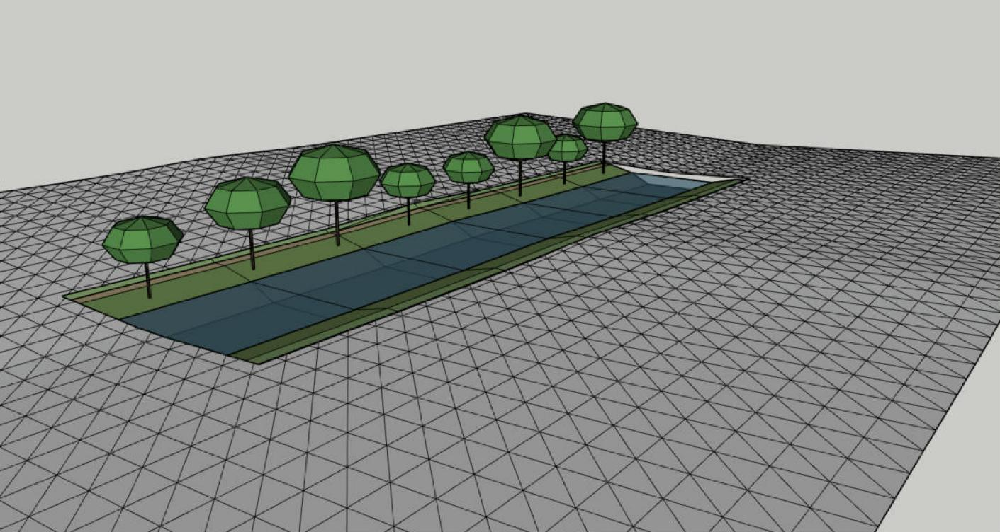

# Recette hôte H23 : eau et littoral, par le service

**Réussie sur la seule combinaison ci-dessous, par le service.** Une rivière posée sur un terrain en vallée suit l'enveloppe descendante : son eau ne remonte jamais, son lit est creusé dans la copie entaillée du terrain, l'original reste masqué et intact. Un canal horizontal et une côte à falaises s'écrivent avec des faces égales au plan. Le panneau de l'eau n'existe pas encore (AG-056) : pas de vrai geste.

| Élément | Valeur |
|---|---|
| Date | 2026-11-08 |
| Code | Copie de développement `0.8.0-dev` installée dans Plugins, non publiée : `pkg/archgen-0.8.0-dev.rbz`, SHA-256 `4c3cd4a8…` |
| OS | Windows 11 Home 10.0.26200 |
| Hôte | SketchUp 2026 Pro, 26.2.243, Ruby embarqué 3.2.2 |
| Sonde | `test/host/h23.rb`, non incluse dans le RBZ ; rapport `tmp/h23.txt` |
| Résultat | 9 contrôles, 0 échec, au troisième passage (deux corrections de la sonde, ci-dessous) |

## Terrain de test

Groupe de 200 × 140 m, grille triangulée au pas de 4 m (3 500 faces) : vallée le long de x, fond en y = 20 m, pente de 1,5 % vers +x, flancs à 4 %, bosse de 0,6 m en x = 70 m. Rivière à berges de 120 m (eau de 18 m, revanche 1,2 m), borne de pente de 5 %.

## Contrôles

| Contrôle | Observé |
|---|---|
| Rivière tracée vers l'amont | Refus `river_upstream`, montée 1,8 m ; document inchangé |
| Créer la rivière : une opération, faces égales au plan | 0,57 s ; racine à 12,053 m ; 478 / 478 faces ; chute 1,800 m ; pente 3,00 % ; déblai 3,40 m, remblai 0 |
| Eau | 7 sections, chacune horizontale ; niveaux de 10,853 à 9,053 m, jamais remontants ; matière « ARCHGEN Eau surface », opacité 0,6 |
| Original et copie | Original : 3 500 faces avant et après, masqué ; une copie entaillée |
| Annuler, Rétablir | Rivière et copie disparaissent, l'original redevient visible ; tout revient |
| Canal horizontal, hors du terrain | 886 / 886 faces ; eau à −0,8 m |
| Côte à falaises | 328 / 328 faces ; mer à −25 m |
| Enregistrer | Fichier `tmp/h23.skp` |

## Écarts

- **Premier passage :** la rivière a été refusée, `grade_too_steep` à 60 m, pente un peu au-delà de 3 % : le terrain de test était plus raide que prévu derrière la bosse. Refus juste ; la sonde règle désormais la borne à 5 %.
- **Deuxième passage :** 8 contrôles sur 9. Le refus à contre-pente était testé après la création de la rivière, sur un terrain déjà masqué : refus `terrain_hidden`, limite existante d'ADR-38 (une seule voie par terrain). La sonde le teste désormais avant.
- **Non couvert :** panneau de l'eau, régime et réglages au panneau (AG-056) ; canal à écluses et un seul niveau sur un terrain (AG-054, AG-055).
