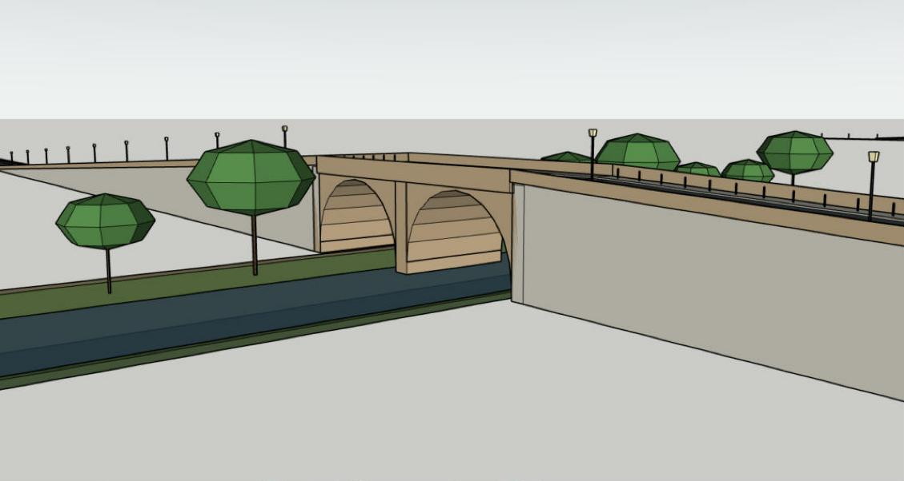

# Recette hôte H24 : ponts, par le service et au panneau

**Réussie sur la seule combinaison ci-dessous, par le service puis au vrai geste.** Une poutre, un arc et une voûte sur une rivière, un pont sur une voie ferrée et un pont entre deux rues s'écrivent avec des faces égales au plan ; Annuler, Rétablir et une régénération poutre → arc gardent le document sain ; une voûte trop basse est refusée sans rien écrire, avec la hauteur qui suffit. Au panneau de réseau, une rivière et une rue tracées à la souris donnent un pont d'office, passé en arc, puis écrit.

| Élément | Valeur |
|---|---|
| Date | 2026-11-08 |
| Code | RBZ `pkg/archgen-0.9.0.rbz` installé dans Plugins (voir le [rapport V0.9](V0.9.md)) |
| OS | Windows 11 Home 10.0.26200 |
| Hôte | SketchUp 2026 Pro, 26.2.243, Ruby embarqué 3.2.2 |
| Sonde | `test/host/h24.rb`, non incluse dans le RBZ ; rapport `tmp/h24.txt` |
| Résultat | 9 contrôles, 0 échec, au troisième passage (deux corrections de la sonde, ci-dessous) |

## Contrôles

| Contrôle | Observé |
|---|---|
| Poutre sur une rivière : pont d'office, une opération | 0,13 s ; 4 696 / 4 696 faces ; tablier à 5,22 m, portée 34 m ; groupes `road/water` et `road/bridges` |
| Annuler, Rétablir | Le réseau disparaît, puis revient |
| Régénérer en arc | Révision 2 ; 4 796 / 4 796 faces |
| Voûte, hauteur libre 9,6 m | 7 022 / 7 022 faces ; tablier à 10,42 m ; deux arches et une pile dans l'eau |
| Voûte à la hauteur libre par défaut | Refus `bridge_clearance`, 9,58 m annoncés ; rien d'écrit |
| Pont sur une voie ferrée | 10 111 / 10 111 faces ; tablier à 7,22 m ; voie portée : la rue |
| Pont entre deux rues, voie portée nommée | 8 584 / 8 584 faces ; tablier à 6,09 m |
| Enregistrer | Fichier `tmp/h24.skp`, quatre réseaux |

Chaque réseau écrit est relu depuis son réglage enregistré : même empreinte, même genre de pont.

## Vrai geste au panneau de réseau

Vue de dessus à l'échelle connue (1,5 px par mètre), tracés à la souris : une rue de 359 m, puis une rivière de 201 m (type choisi au clavier dans la liste). Le carrefour est apparu en **Pont**, genre Poutre, « 1 pont » dans le résumé ; passé en **Arc** dans la liste du genre, le résumé a été recalculé (4 352 faces au lieu de 4 252) ; **Créer le réseau** a écrit le réseau.

## Écarts

- **Premier passage :** la voûte sur la rivière refusée `arm_too_short` : avec 9,6 m de hauteur libre, le tablier est à 10,42 m et les rampes font 208 m, plus que la rue de la sonde. Refus juste ; la sonde allonge la rue.
- **Deuxième passage :** erreur Ruby dans la sonde (un réglage passé comme mots-clés), corrigée.
- **Pendant le geste :** une longueur tapée au clavier n'atteint pas l'outil de tracé depuis l'automatisation (le champ la montre, Entrée n'agit pas), comme à la recette 0.8.0 ; tracé fait à la souris. Un clic sur une option de liste déroulante n'est pas pris non plus : choix faits au clavier. À vérifier à la main par le propriétaire.
